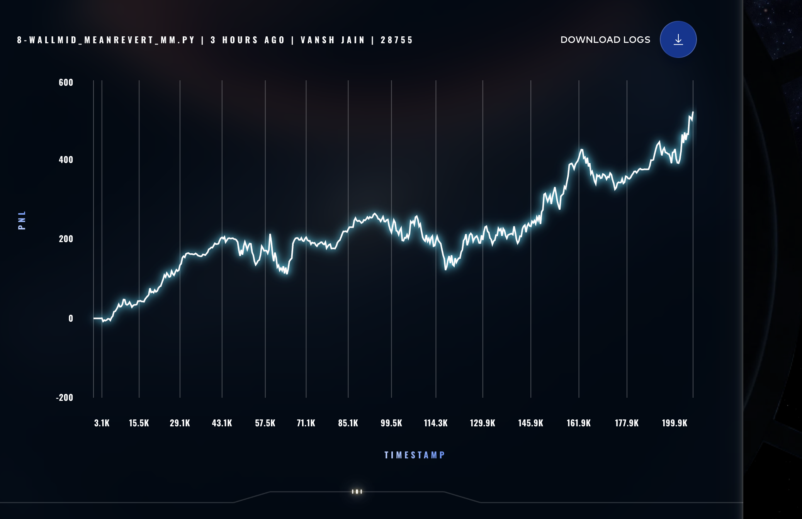

# 🚀 IMC4 – Algorithmic Trading Strategies in Python

A collection of algorithmic trading strategies implemented in Python, focusing on quantitative techniques such as Monte Carlo simulations and mean reversion market making.

---

## 📌 Overview

This project demonstrates the design and evaluation of trading strategies using simulation-based approaches.
It highlights strong skills in:

* Quantitative analysis
* Algorithm design
* Data-driven decision making

---

## 🧠 Strategies Implemented

### 🔹 Monte Carlo Trading

* Simulates multiple price paths
* Estimates expected returns and risk
* Useful for probabilistic decision making

---

### 🔹 WallMid Mean Reversion Market Making

* Assumes price reverts to a mean (mid-price)
* Places buy/sell orders around mid-price
* Profits from short-term inefficiencies

---

## 📊 Strategy Performance

### WallMid Mean Reversion Market Making



**Observations:**

* Consistent upward PnL trend
* Handles volatility effectively
* Shows robustness across time

---

## 📂 Project Structure

```
IMC4/
├── datamodel.py
├── monte_carlo_trader.py
├── wallmid_meanrevert_mm.py
├── test_monte_carlo.py
├── test_trader.py
├── README.md
├── LICENSE
└── .gitignore
```

---

## ⚙️ Setup & Usage

### 1. Clone the repository

```
git clone https://github.com/v-oss891/IMC4.git
cd IMC4
```

### 2. Run strategy

```
python monte_carlo_trader.py
```

### 3. Run tests

```
python test_trader.py
```

---

## 📈 Future Improvements

* Add performance metrics (Sharpe ratio, drawdown)
* Integrate real market data APIs
* Build backtesting engine
* Add visualization dashboards

---

## 👨‍💻 Author

**Vansh Jain**

---

## 📜 License

This project is licensed under the MIT License.
