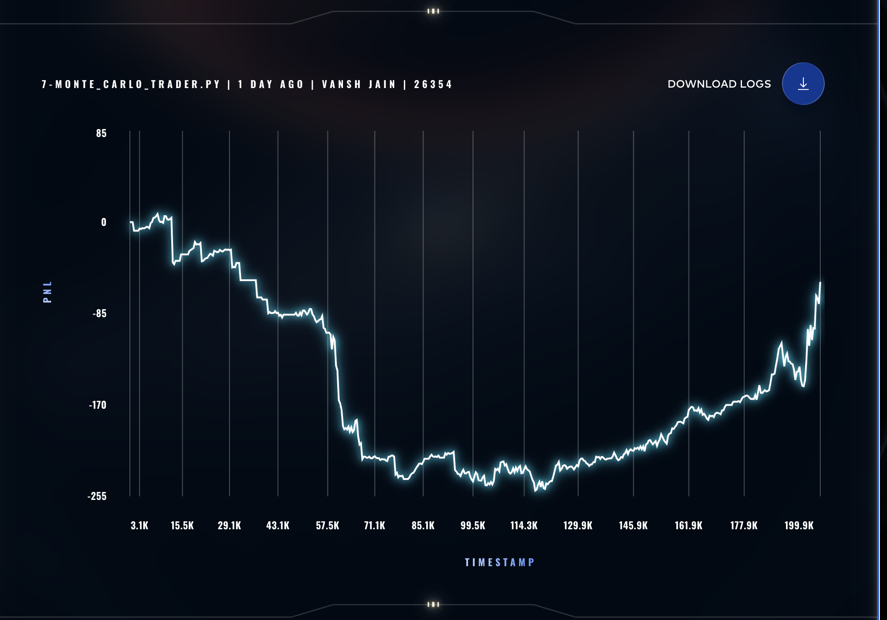

# 📊 Monte Carlo Trading Strategy

## 📈 Performance

---

## 📊 Observations

- Initial drawdown observed  
- Gradual recovery in later stages  
- High variance due to randomness  
- Less stable compared to mean reversion  

---

## 📌 Notes

- Based on stochastic price simulations  
- Performance depends on random paths  
- Useful for risk estimation and modeling  